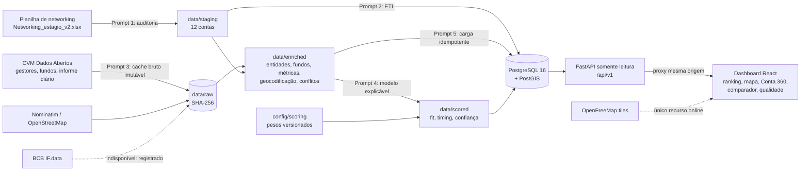

# Arquitetura

MVP de priorização comercial explicável para 12 contas-piloto. O objetivo não é prever compra, e sim reduzir o tempo de preparação de uma conta, com cada número rastreável à fonte.

## Fluxo



Versão em texto:

```
planilha ─► staging ─┐
CVM/OSM ─► raw (sha256, imutável) ─► enriched ─► scored ─┬─► PostgreSQL/PostGIS ─► FastAPI ─► React
                                     config/scoring ─────┘        (leitura)        (/api/v1)   (proxy)
```

## Componentes

| Camada | Onde | Responsabilidade |
|---|---|---|
| Auditoria e staging | `scripts/audit_networking.py`, `data/staging/` | Recorte das 12 contas, contrato de dados, nada é promovido a fato sem fonte |
| Enriquecimento | `src/networking_intel/enrichment/` | Conectores com cache imutável, retries limitados, rate limit, freshness, fila de conflitos |
| Modelo | `src/networking_intel/scoring/`, `config/scoring/opportunity_v1.yaml` | Fit, timing e confiança separados; ausência vira faixa, não zero; sensibilidade e sanidade |
| Banco | `migrations/`, `src/networking_intel/db/` | Esquema com constraints (CNPJ válido, precisão geográfica coerente, faixas 0–100) |
| Carga | `src/networking_intel/etl/` | ETL e carga idempotentes, `COPY` para o painel diário, impressão digital determinística |
| API | `src/networking_intel/api/` | Transação somente leitura, RFC 7807, correlation id, métricas, rate limit, ETag de revalidação |
| Dashboard | `frontend/` | Cinco telas, filtros na URL, mapa MapLibre, estados de carregamento, vazio, erro, vencido e conflito |
| Demo | `scripts/demo.py` | Banco do zero até API + dashboard em modo DEMO com um comando, sem rede |

## Decisões e trade-offs

| Decisão | Alternativa descartada | Por quê | Custo aceito |
|---|---|---|---|
| Três saídas (fit, timing, confiança) | Um score único de "propensão" | Não há variável-alvo histórica; um número único esconderia premissas e incerteza | O vendedor lê três números em vez de um |
| Dado ausente vira faixa mín–máx | Imputar zero ou média | Ausência de registro não é evidência de ausência | Rankings com faixas largas quando falta timing |
| Pesos especialistas versionados em YAML | ML supervisionado | Sem resultados de oportunidades não há o que treinar; a interface de calibração já existe | Pesos são premissas até haver dados do CRM |
| Vínculo de fundos só por CNPJ exato | Similaridade de nomes | Erro silencioso de vínculo contamina PL, fluxo e retorno | Afiliadas dependem do registro curado e da revisão humana |
| Bancos pontuados por mesa | Banco como unidade | A venda acontece por área (trading, research, dados) | Mesas sem entidade pública ficam como premissa e não comparam com gestoras |
| PostgreSQL + PostGIS portátil local | SQLite ou arquivos | Constraints reais, índice GiST, mesmo motor do Docker | Instalação local fora do Docker nesta máquina |
| Cache bruto imutável com SHA-256 | Baixar a cada execução | Reprodutibilidade e auditoria; respeita as fontes | ~150 MB locais fora do git |
| API somente leitura | CRUD | Nada no MVP precisa escrever; reduz a superfície de ataque | Revisão de conflitos é feita no CSV, não na interface |
| Revalidação com ETag e `no-cache` | Cache com TTL | Uma nova carga aparece imediatamente | Uma ida ao servidor por requisição |
| Tabela própria no frontend | TanStack Table v9 | 22 linhas; API nova instável; acessibilidade sob controle | Ordenação e colunas escritas à mão |
| Basemap público (OpenFreeMap) | Tiles embarcados | Zero custo e sem chave | Sem internet o mapa perde o fundo (os pontos continuam) |

## Segurança e privacidade (resumo)

Detalhes em `docs/security_review.md`. Destaques: API somente leitura com timeout de consulta e conexão; CORS restrito a GET e às origens configuradas; hosts confiáveis explícitos; CSP no build do dashboard; nenhum segredo versionado; logs sem query string, IP ou variáveis locais; e-mails pessoais descartados na coleta; pessoas restritas ao diretor de gestão registrado na CVM.

## Como os dados mudam

1. `python -m networking_intel.enrichment.cli` (online, respeita cache e rate limit)
2. `python -m networking_intel.scoring.cli` (determinístico a partir dos arquivos)
3. `python -m networking_intel.etl.load_enriched` (idempotente)
4. A API e o dashboard refletem a nova carga na próxima requisição.
